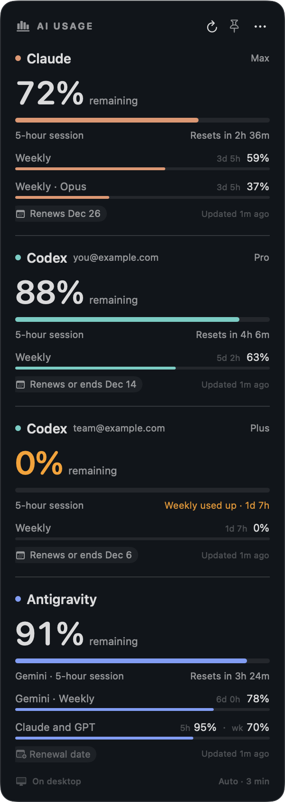
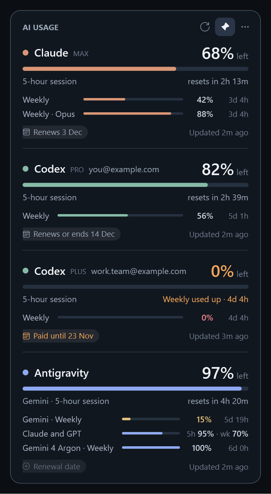

<div align="center">


# AI Usage Widget

**See how much of your Claude, ChatGPT/Codex and Gemini subscriptions is left, right on your desktop.**

Native apps for macOS and Windows · Free and open source (MIT)

[Website](https://marioarttv.github.io/AIUsageWidget/) ·
[Download](https://github.com/Marioarttv/AIUsageWidget/releases/latest) ·
[Mac guide](docs/MACOS.md) ·
[Windows guide](docs/WINDOWS.md)

[](https://github.com/Marioarttv/AIUsageWidget/actions/workflows/macos.yml)
[](https://github.com/Marioarttv/AIUsageWidget/actions/workflows/windows.yml)
[](LICENSE)

&nbsp;&nbsp;&nbsp;

<sub>macOS (left) and Windows (right), shown with sample data</sub>

</div>

## What it does

AI coding subscriptions come with 5-hour and weekly limits. This widget keeps them in view so you're never surprised by a limit halfway through a task.

- **Claude** (Pro and Max): the 5-hour session, the weekly limit and model-specific weekly limits, for your whole account.
- **ChatGPT / Codex**: the Codex limits of your ChatGPT plan, for **several accounts** if you have them.
- **Antigravity (Google Gemini)**: Gemini's 5-hour and weekly limits and the *Claude and GPT* group, when the Antigravity CLI is installed.
- **What's really left:** once a weekly limit is used up, the shorter limits it covers show 0%, with the time it comes back.
- **Notifications** when a 5-hour limit drops below 10% and when a limit has reset.
- **Renewal dates** for each subscription, in a small calendar.
- Sits on the desktop or stays on top. On macOS the menu bar shows one number per provider; on Windows a small strip next to the taskbar clock does.

It uses the sign-ins of the tools you already have (Claude Code, the Codex CLI, the Antigravity CLI), starts no AI conversations, and sends nothing anywhere else. See [Privacy](#privacy).

## Install on macOS

Requires macOS 13 or newer, on Apple silicon or Intel.

1. Download **[AIUsageWidget-macOS.zip](https://github.com/Marioarttv/AIUsageWidget/releases/latest/download/AIUsageWidget-macOS.zip)** and double-click it to unzip.
2. Drag **AI Usage Widget** into your **Applications** folder.
3. Open it. The app isn't notarized by Apple, so the first launch is blocked:
   - **macOS 15 and newer:** click **Done** in the warning, open **System Settings → Privacy & Security**, scroll down and click **Open Anyway** next to “AI Usage Widget”, then confirm.
   - **macOS 13 and 14:** right-click the app, choose **Open**, then **Open** again.
   - Or in Terminal: `xattr -dr com.apple.quarantine "/Applications/AI Usage Widget.app"`
4. Allow notifications when asked. The widget appears on the desktop and its readings in the menu bar. Click the menu-bar item for the full view, and use **⋯** for settings such as **Launch at Login**.

**Build from source instead** (needs Xcode 15 or newer):

```sh
git clone https://github.com/Marioarttv/AIUsageWidget.git
cd AIUsageWidget
./macOS/scripts/install.sh
```

This builds the app, signs it with your Apple Development identity if you have one (ad hoc otherwise), installs it to `~/Applications/AI Usage Widget.app` and opens it. Run it again to update; quit the widget first.

## Install on Windows

Requires 64-bit Windows 10 or 11. The download includes everything it needs; no .NET installation is required.

1. Download **[AIUsageWidget-windows-x64.zip](https://github.com/Marioarttv/AIUsageWidget/releases/latest/download/AIUsageWidget-windows-x64.zip)** (or **[-arm64](https://github.com/Marioarttv/AIUsageWidget/releases/latest/download/AIUsageWidget-windows-arm64.zip)** for ARM PCs such as Snapdragon laptops; not yet tested on real ARM hardware).
2. Right-click the zip → **Extract All…**, and extract it to a permanent folder, for example `%LOCALAPPDATA%\Programs`. Keep the files together. The app saves its data in `%LOCALAPPDATA%\AIUsageWidget`, never beside itself.
3. Open the **AI Usage Widget** folder and double-click **AIUsageWidget.exe**. The app isn't code-signed, so Windows SmartScreen may say “Windows protected your PC”: click **More info → Run anyway**.
4. The widget opens on top of other windows, and a usage strip appears next to the taskbar clock. Open **⋯** to turn on **Start with Windows** or pick a light theme, and click the pin to move the widget onto the desktop behind your windows.

To update, quit the widget (**⋯ → Quit**) and replace the folder with the new one.

**Build from source instead** (needs the [.NET 10 SDK](https://dotnet.microsoft.com/download/dotnet/10.0)):

```powershell
git clone https://github.com/Marioarttv/AIUsageWidget.git
cd AIUsageWidget
.\START-WIDGET.cmd
```

`START-WIDGET.cmd` builds the app into the `app` folder the first time and starts it. `SHOW-WIDGET.cmd` brings a running widget forward and recentres it.

## Connect your subscriptions

The widget reads the sign-ins of the official tools. Sign in once in each tool you use; a provider you don't use simply stays empty.

| Provider | What to install and sign in | Notes |
| --- | --- | --- |
| Claude (Pro or Max) | [Claude Code](https://code.claude.com/docs/en/setup), signed in with your Claude subscription | On macOS, if the widget asks, choose **⋯ → Connect Claude…** to allow Keychain access. |
| ChatGPT / Codex | [Codex CLI](https://learn.chatgpt.com/docs/codex/cli), signed in with *Sign in with ChatGPT* | More accounts: sign them in to [Codex Subscription Router](https://github.com/b-nnett/codex-subscription-router), or add another Codex sign-in folder in **⋯ → ChatGPT Accounts**. |
| Antigravity (Gemini) | The [Antigravity](https://antigravity.google) CLI, signed in with your Google account | Optional. Appears by itself once the CLI is found; turn it off with **⋯ → Show Antigravity**. |

Readings refresh every few minutes; **↻** refreshes now. The details, including where each app looks for the CLIs, are in the [Mac guide](docs/MACOS.md) and the [Windows guide](docs/WINDOWS.md).

## Privacy

- Everything runs on your computer. There is no account, server, analytics or telemetry.
- The widget asks each provider for your **usage only**: Claude's account usage endpoint (the one behind Claude Code's `/usage`), the Codex CLI's `account/rateLimits/read`, and the Antigravity CLI's `/usage` command. It never starts a model conversation, so readings cost no tokens.
- Sign-in tokens are only used in memory for those requests. They are never written to the widget's files or logs, and the Antigravity token is never read at all.
- Saved data is limited to recent readings, alert history and settings, in `~/Library/Application Support/AIUsageWidget` (macOS) or `%LOCALAPPDATA%\AIUsageWidget` (Windows).

**This is an unofficial tool, provided as is (see [License](#license)).** It reads your own sign-ins on your own computer and only asks for usage numbers, but providers can change or restrict that access at any time. Claude's usage endpoint isn't a documented public API, and Anthropic's [policy on subscription sign-ins](https://code.claude.com/docs/en/legal-and-compliance#authentication-and-credential-use) reserves the right to restrict how they're used. Use it at your own risk.

## Uninstall

- **macOS:** turn off **Launch at Login** in **⋯**, quit from the menu bar, delete the app, and optionally `~/Library/Application Support/AIUsageWidget`.
- **Windows:** turn off **Start with Windows** in **⋯**, choose **Quit**, delete the app folder, and optionally `%LOCALAPPDATA%\AIUsageWidget`. If you connected the optional Claude status-line feed, run `DISCONNECT-CLAUDE.cmd` from the app folder first.

Your Claude, Codex and Antigravity sign-ins are not affected.

## Development

| | macOS | Windows |
| --- | --- | --- |
| Code | `macOS/` (Swift, SwiftUI, AppKit) | `src/UsageWidget/` (C#, WPF, .NET 10) |
| Tests | `swift test --package-path macOS` | `dotnet run --project tests/CoreTests/CoreTests.csproj -c Release` (logic only, any OS: `tests/LogicTests`) |
| Guide | [docs/MACOS.md](docs/MACOS.md) | [docs/WINDOWS.md](docs/WINDOWS.md) |

Releases are built by GitHub Actions when a `v*` tag is pushed (see `.github/workflows/release.yml`). Contributions are welcome: please read [CONTRIBUTING.md](CONTRIBUTING.md), and report security issues as described in [SECURITY.md](SECURITY.md).

## License

[MIT](LICENSE). Claude, ChatGPT, Codex, Gemini and Antigravity are trademarks of Anthropic, OpenAI and Google. This project isn't affiliated with or endorsed by them. Provider marks come from [Simple Icons](https://simpleicons.org) (CC0).
