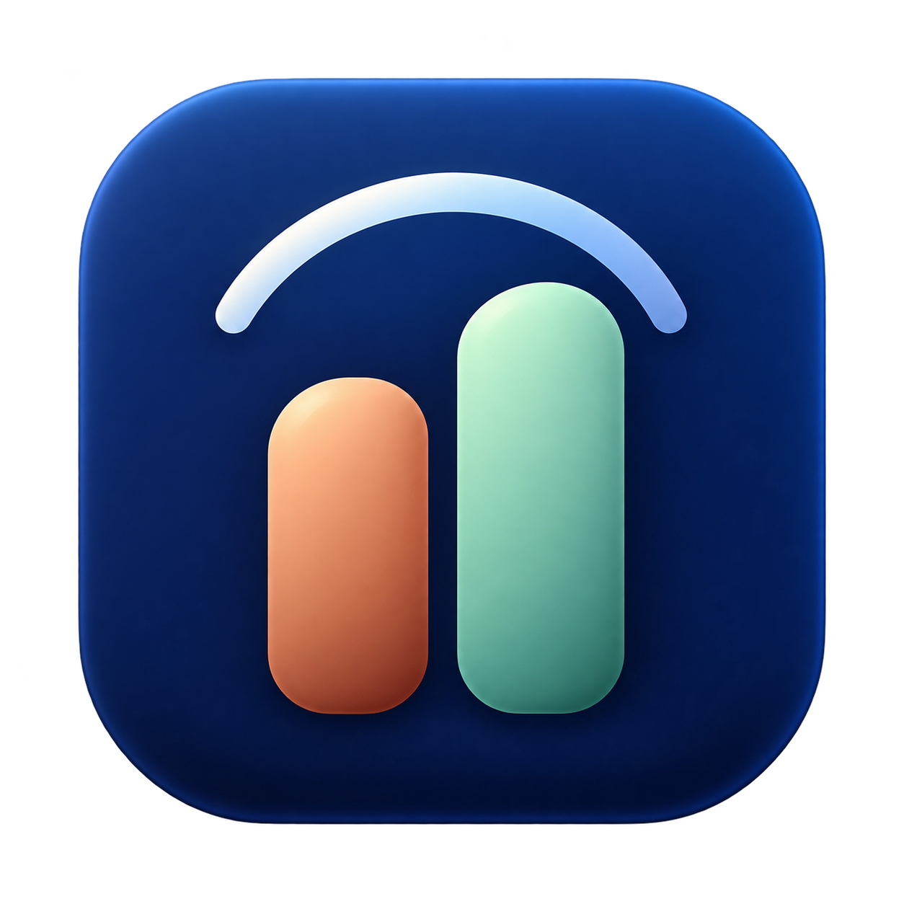

# AI Usage Widget

A Windows desktop widget for Claude and Codex subscription allowances and reset times. It shows remaining allowance, saves its position, and supports always-on-top and desktop views.



## Run

Double-click `START-WIDGET.cmd`. If the app has not been built yet, the launcher publishes it into the ignored `app/` folder before starting it. Double-click `SHOW-WIDGET.cmd` to bring an existing widget forward and recenter it on the primary monitor.

Requirements:

- Windows with the .NET 10 Windows Desktop runtime; the .NET 10 SDK is needed to build from source.
- An installed and signed-in Codex CLI for Codex subscription readings.
- Node.js and Claude Code 2.1.251 or newer for the Claude usage feed.

After building, run `app/CONNECT-CLAUDE.cmd` to connect the Claude feed. Setup saves the previous Claude status line and preserves all other settings. Run `app/DISCONNECT-CLAUDE.cmd` to restore it. Reconnect if the app folder is moved.

## Controls

- Drag the title to reposition the widget.
- Use the arrow to switch between always on top and the desktop view. In desktop view, other windows cover it.
- Click **↻** to refresh Codex. Automatic refresh runs every 90 seconds.
- Hover over a countdown for the exact local reset date and time.
- Open **⋯** for **Start with Windows**, **Hide**, and **Quit**.
- Enable **Start with Windows** once to launch the app when signing in after a shutdown or restart.
- Double-click the tray icon to bring the widget forward.

New installations start in always-on-top mode so the widget is easy to find. Desktop attachment can depend on the Windows shell; use always-on-top mode or `SHOW-WIDGET.cmd` if it is hidden.

## How readings work

Bars show **remaining** subscription allowance. Missing readings show a dash. Expired quota windows wait for a new reading rather than assuming the allowance has replenished.

Codex uses the local CLI's documented `account/rateLimits/read` app-server method. Window labels follow the account's actual duration, and multiple quota buckets are supported.

Claude uses the documented status-line `rate_limits` fields. Its first reading is available after a Claude Code response. Other Claude activity may not appear until Claude Code supplies its next reading, so the widget displays when the last reading was taken. Restart an existing Claude Code session if it has not picked up the new status-line command.

The status-line wrapper runs the previous status-line command. If it fails, the wrapper displays a simple model/context status line. The widget does not generate model requests or store conversations or authentication tokens.

Local snapshots, settings, a short log, and the original Claude configuration backup are stored under `%LOCALAPPDATA%\AIUsageWidget`, outside the repository.

The app, taskbar, and tray share the generated artwork in `assets/widget.ico`. The PNG master and generation prompt are kept in `assets/`. The Windows icon contains multiple sizes for different display scales.

To recreate the ICO from the generated PNG master, run `python scripts/create-icon.py` with Pillow installed. Python is only needed for asset packaging, not to build or run the widget.

## Build and check

```powershell
dotnet publish src/UsageWidget/UsageWidget.csproj -c Release -o app
node --test tests/bridge.test.cjs tests/setup.test.cjs
dotnet run --project tests/CoreTests/CoreTests.csproj -c Release
```

The publish command includes the Claude bridge, setup scripts, launchers, and user guide. Build output and local usage data are not committed.

To run a live Codex connection check without opening the widget:

```powershell
Start-Process app/AIUsageWidget.exe -ArgumentList '--check' -Wait
Get-Content "$env:LOCALAPPDATA/AIUsageWidget/check-result.json"
```

## Remove

Disable **Start with Windows**, choose **Quit**, and run `app/DISCONNECT-CLAUDE.cmd`. Local readings and configuration backups can be removed separately when no longer needed.

## Data interface documentation

- [Codex app server](https://learn.chatgpt.com/docs/app-server)
- [Claude Code status line](https://code.claude.com/docs/en/statusline)
